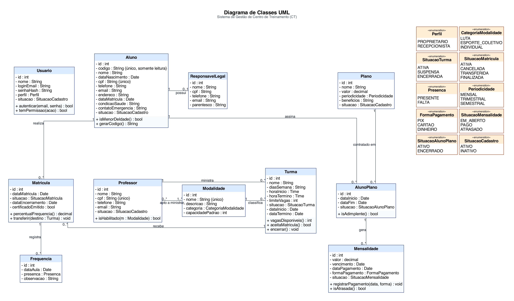
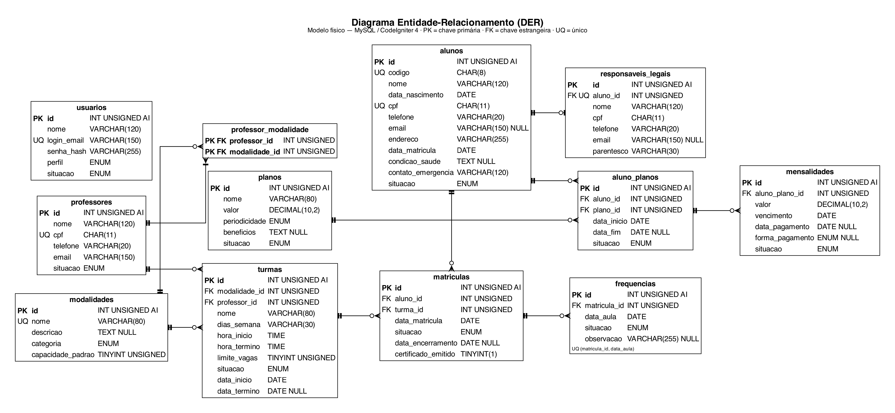

INSTITUTO FEDERAL DO ESPÍRITO SANTO BACHARELADO EM SISTEMAS DE INFORMAÇÃO DESENVOLVIMENTO WEB

ARTHUR MARQUES, ARTHUR VITAL, GABRIEL ABREU, INÁCIO ALMEIDA, JOÃO PAULO CASTANHEIRA, PEDRO GRONER E VITOR FREIRE

DOCUMENTO DE ANÁLISE DE NEGÓCIO

SISTEMA WEB DE GESTÃO DE CENTRO DE TREINAMENTO (CT)

Versão 4.0 — análise de negócio e rastreabilidade da implementação

SERRA 2026

SUMÁRIO

<!--SUMARIO-->

# 1. Introdução e delimitação do projeto

## 1.1 Contexto

Centros de treinamento precisam manter informações consistentes sobre alunos, responsáveis legais, professores, modalidades, turmas, matrículas, presenças e pagamentos. Mesmo quando o volume de alunos é moderado, essas atividades se relacionam: uma matrícula depende da disponibilidade da turma; a turma depende de modalidade e professor habilitado; o acompanhamento financeiro depende do plano e das mensalidades; e a gestão precisa consultar dados confiáveis para tomar decisões.

O projeto transforma esse minimundo em uma aplicação web, com foco na organização dos dados e na aplicação das regras de negócio durante as operações administrativas.

## 1.2 Objetivo geral

Planejar e desenvolver, de forma incremental, um sistema web que centralize os principais processos administrativos de um centro de treinamento, reduzindo retrabalho e apoiando o controle de alunos, turmas, frequência e cobranças.

## 1.3 Objetivos específicos

- Centralizar os cadastros de alunos, responsáveis, professores e modalidades.
- Organizar turmas com horários, professor responsável, situação e limite de vagas.
- Controlar matrículas, transferências e ocupação das turmas.
- Registrar presença e falta por aula.
- Cadastrar planos e registrar mensalidades, pagamentos e atrasos.
- Disponibilizar consultas e relatórios operacionais e financeiros conforme o perfil de acesso.
- Aplicar autenticação, autorização, validação no servidor e medidas básicas de segurança.
- Documentar a instalação, configuração e utilização do projeto.

## 1.4 Delimitação do escopo

- **Incluído no escopo planejado:** cadastro e consulta dos dados centrais; gestão de modalidades, professores e turmas; matrícula e controle de lotação; frequência; planos e mensalidades; relatórios básicos; autenticação e permissões; interface responsiva; documentação técnica.
- **Fora do MVP inicial:** aplicativo móvel nativo, integração bancária, conciliação automática, cobrança automática por WhatsApp, integração com gateways de pagamento e recursos avançados de BI. Esses itens podem ser avaliados em versões futuras, após validação do núcleo do produto (ver decisões da análise SWOT, seção 9).

# 2. Problema de negócio e oportunidade

## 2.1 Problema central

O problema central é a ausência de um fluxo administrativo integrado e confiável para acompanhar alunos, ocupação das turmas, frequência e situação financeira. Quando cada informação é mantida em uma planilha ou canal diferente, a equipe precisa cruzar dados manualmente e depende de atualização disciplinada de todos os envolvidos.

**Enunciado delimitado do problema:** *centros de treinamento de pequeno porte em Serra e Vitória (ES), que operam com planilhas e WhatsApp, não conseguem saber com rapidez e segurança quem está matriculado, quantas vagas restam em cada turma, quem está faltando e quem está inadimplente.*

## 2.2 Dores operacionais

- **Dados dispersos:** informações de contato, matrícula e pagamento ficam em arquivos ou conversas diferentes.
- **Duplicidade e desatualização:** o mesmo aluno pode aparecer em mais de um registro ou com dados divergentes.
- **Lotação incerta:** a equipe precisa contar matrículas manualmente para confirmar se ainda há vagas.
- **Inadimplência pouco visível:** cobranças vencidas podem não ser identificadas rapidamente.
- **Frequência trabalhosa:** registros manuais dificultam a apuração de faltas e do percentual de presença.
- **Dependência de pessoas específicas:** o conhecimento sobre controles e planilhas pode ficar concentrado em um único funcionário.
- **Baixa rastreabilidade:** correções e atualizações podem ocorrer sem histórico claro.
- **Decisão tardia:** sem consultas consolidadas, o gestor gasta tempo reunindo informações antes de agir.

## 2.3 Consequências para o negócio

Essas dificuldades podem aumentar o retrabalho, prejudicar a experiência de atendimento, permitir erros de matrícula e dificultar o planejamento de turmas e receitas. A proposta não presume que todos esses problemas ocorram em todos os centros; são hipóteses coerentes com o cenário de gestão manual, a serem confirmadas pelas entrevistas previstas no Apêndice A.

## 2.4 Oportunidade

O número de academias e centros de treinamento no Brasil quase triplicou em dez anos, de 19.266 estabelecimentos em 2014 para 56.833 em 2024 (Panorama Setorial Fitness Brasil 2024). O Espírito Santo é o terceiro estado com maior densidade de centros, com 4,4 centros por 10 mil habitantes, contra a média nacional de cerca de 2,9 (Panorama Setorial Fitness Brasil, 5ª edição). Há, portanto, um mercado regional denso e em crescimento.

Há espaço para uma ferramenta focada no núcleo administrativo de centros de pequeno porte, sem começar por integrações complexas. O diferencial pretendido é combinar simplicidade de uso com regras de negócio específicas: bloqueio de matrícula em turma lotada ou suspensa, vínculo de professor apto à modalidade, controle de adimplência e certificado por frequência mínima.

# 3. Solução proposta e proposta de valor

## 3.1 Solução

A solução é uma aplicação web responsiva que reúne os registros operacionais em um banco de dados relacional e disponibiliza telas para cadastro, consulta, edição e acompanhamento. O acesso é autenticado e as funcionalidades são disponibilizadas conforme o perfil do usuário.

## 3.2 Proposta de valor

> **Para** proprietários de centros de treinamento de lutas e esportes coletivos de pequeno porte **que** controlam alunos, turmas e mensalidades em planilhas e WhatsApp, **o Sistema CT é** uma aplicação web de gestão operacional **que** mostra em poucos cliques quem está matriculado, quantas vagas restam e quem está inadimplente, e impede matrículas inválidas. **Diferente** de planilhas, aplica as regras do negócio automaticamente; **diferente** de sistemas de nicho focados só em jiu-jitsu, atende várias modalidades (lutas e esportes coletivos) com regras de lotação por categoria.

## 3.3 Benefícios esperados

| Benefício | Mecanismo proposto | Resultado a verificar |
|---|---|---|
| Agilidade no atendimento | Busca centralizada de alunos e matrículas | Menor tempo para localizar e atualizar registros |
| Controle de vagas | Contagem de matrículas ativas por turma | Menos erros de lotação |
| Visibilidade financeira | Lista de mensalidades vencidas e situação do plano | Identificação mais rápida de pendências |
| Consistência | Validações e regras no servidor | Menos registros inválidos ou contraditórios |
| Controle de acesso | Permissões por perfil | Menor exposição de informações restritas |
| Continuidade operacional | Backup e documentação | Maior capacidade de recuperação e manutenção |

# 4. Público-alvo, segmentação e personas

## 4.1 Público-alvo inicial

O segmento inicial são centros de treinamento esportivo independentes de pequeno porte, com ênfase em academias de lutas e espaços de esportes coletivos, localizados em Serra e Vitória (ES). A escolha geográfica facilita a prospecção presencial, as entrevistas exploratórias e o suporte local.

## 4.2 Segmentação

+----------------------------+--------------------------+------------------------------------------------+
| Dimensão                   | Critério                 | Definição para o Sistema CT                    |
+============================+==========================+================================================+
| **Geográfica**             | Localização              | Serra (577.060 hab.) e Vitória (343.378 hab.), |
|                            |                          | estimativas IBGE de 2025; expansão posterior   |
|                            |                          | para Vila Velha e Cariacica                    |
+----------------------------+--------------------------+------------------------------------------------+
| **Demográfica (da          | Tipo de negócio          | Academia de lutas, centro de artes marciais ou |
| empresa)**                 |                          | espaço de esportes coletivos                   |
|                            +--------------------------+------------------------------------------------+
|                            | Porte                    | Até ~150 alunos ativos, de 3 a 15 turmas,      |
|                            |                          | equipe administrativa de 1 a 3 pessoas         |
|                            +--------------------------+------------------------------------------------+
|                            | Natureza                 | Independente (não pertence a rede ou franquia) |
+----------------------------+--------------------------+------------------------------------------------+
| **Demográfica (do          | Perfil                   | Proprietário-gestor, 30 a 50 anos, geralmente  |
| decisor)**                 |                          | ex-atleta ou professor da modalidade           |
+----------------------------+--------------------------+------------------------------------------------+
| **Comportamental**         | Maturidade digital       | Usa smartphone, WhatsApp e planilhas, mas não  |
|                            |                          | usa sistema de gestão integrado                |
|                            +--------------------------+------------------------------------------------+
|                            | Necessidade principal    | Consolidar cadastros, matrículas, frequência e |
|                            |                          | cobranças                                      |
|                            +--------------------------+------------------------------------------------+
|                            | Sensibilidade a preço    | Alta: compara com o custo zero da planilha     |
|                            +--------------------------+------------------------------------------------+
|                            | Processo de compra       | Decisão do proprietário; usuário diário é o    |
|                            |                          | recepcionista                                  |
+----------------------------+--------------------------+------------------------------------------------+

**Por que esse público precisa da solução:** centros de lutas e coletivos têm turmas com **limite físico de vagas** (tatame, quadra) e **frequência** como critério de evolução e certificação. Essas regras não aparecem em planilhas genéricas. Ao mesmo tempo, esses centros são pequenos demais para sistemas corporativos de academia, cujo custo estimado é de R$ 800 a R$ 6.500 por mês (seção 11).

## 4.3 Persona principal — proprietário do centro

| Campo | Descrição |
|---|---|
| **Nome** | Marcos Almeida |
| **Idade** | 39 anos |
| **Profissão / papel** | Proprietário e gestor de um centro de lutas de bairro na Serra (jiu-jitsu, muay thai e uma turma de vôlei) e professor de jiu-jitsu |
| **Contexto de uso** | Coordena 4 professores e 9 turmas, com cerca de 110 alunos. Resolve a parte administrativa entre uma aula e outra, no celular, e no fim do dia no computador da recepção |
| **Comportamento digital** | Usa smartphone Android o dia inteiro: WhatsApp Business para falar com alunos, Instagram para divulgar o centro, app do banco para conferir PIX recebidos. Controla mensalidades em uma planilha do Google Sheets compartilhada com a recepcionista. Não tem paciência para sistemas com muitos menus; desistiu de um sistema de academia anterior por achá-lo "feito para academia de musculação" |
| **Objetivos** | Consultar rapidamente alunos ativos e vagas disponíveis; visualizar matrículas e mensalidades; reduzir retrabalho administrativo; tomar decisões com informações centralizadas; manter o controle sem depender de conhecimento técnico |
| **Dores** | Não ter certeza de que a planilha é a versão mais atual; cruzar listas de alunos, turmas e pagamentos à mão; descobrir tarde que uma turma lotou; conferir manualmente quem está inadimplente; depender de memória e anotações; rejeitar sistemas complexos ou com treinamento longo |
| **Citação representativa** | "Eu só quero abrir o celular e saber quem não pagou e se cabe mais um aluno na turma das 19h." |

**Rotina ilustrativa:** Marcos começa o dia respondendo mensagens de alunos e professores. Ao longo do expediente, responde dúvidas sobre horários, confirma matrículas e tenta acompanhar pagamentos conferindo o extrato do PIX contra a planilha. No fechamento do mês, reúne as informações para entender atrasos e organizar o período seguinte.

**Critérios de sucesso para Marcos:** localizar um aluno, conferir uma turma e verificar pendências com poucos passos; impedir operações inválidas; ver as informações em linguagem clara. Esses critérios se tornam testes de aceitação (seção 6).

## 4.4 Persona secundária — recepcionista

| Campo | Descrição |
|---|---|
| **Nome** | Camila Santos |
| **Idade** | 27 anos |
| **Profissão / papel** | Recepcionista e apoio administrativo, cursando Administração à noite |
| **Contexto de uso** | Atende presencialmente e por mensagens, cadastra alunos, atualiza contatos, faz matrículas e registra presenças, inclusive em horários de pico (18h às 21h) |
| **Comportamento digital** | Alterna entre o computador da recepção (WhatsApp Web e planilha abertos) e o celular. Digita rápido, usa atalhos e prefere formulários curtos. Está acostumada com apps de banco e de delivery e espera o mesmo nível de clareza |
| **Objetivos** | Cadastrar e matricular sem erro; encontrar um aluno pelo nome ou código; registrar a chamada em menos de 2 minutos por turma |
| **Dores** | Formulários longos; não saber se a turma ainda tem vaga; mensagens de erro que não explicam o que corrigir; retrabalho quando o proprietário altera a planilha |
| **Necessidades de usabilidade** | Formulários curtos e com campos claros; busca por nome ou código; mensagens de validação que indiquem o que corrigir; confirmação visual de sucesso ou falha; navegação compatível com telas menores; prevenção de erros como matrícula em turma lotada ou suspensa |

**Restrições de acesso:** Camila pode cadastrar e atualizar alunos, organizar matrículas e registrar frequência. Não pode acessar relatórios financeiros restritos nem alterar configurações exclusivas do proprietário. A autorização é verificada no servidor, e não apenas pela ocultação de botões (RN05).

## 4.5 Fundamentação das personas

As personas combinam **dados públicos** com **hipóteses a validar em campo**, e cada afirmação está classificada como uma ou outra:

| Elemento da persona | Base | Situação |
|---|---|---|
| Mercado regional denso (4,4 centros por 10 mil hab. no ES) | Panorama Setorial Fitness Brasil, 5ª edição | Dado público |
| Crescimento do setor (19.266 → 56.833 estabelecimentos) | Panorama Setorial Fitness Brasil 2024 | Dado público |
| Existência de softwares de nicho para lutas (R$ 69 a R$ 269/mês) | Sites dos fornecedores (seção 11.1) | Dado público |
| Uso de planilha e WhatsApp como controle principal | Observação da equipe e entrevistas (Apêndice A) | **Hipótese a validar** |
| Faixa de porte (até ~150 alunos, 3 a 15 turmas) | Entrevistas (Apêndice A) | **Hipótese a validar** |
| Disposição a pagar até R$ 149/mês | Teste de preço nas entrevistas (Apêndice A, bloco 5) | **Hipótese a validar** |

A equipe deve conduzir **pelo menos 3 entrevistas** com gestores de centros em Serra/Vitória, usando o roteiro do Apêndice A, e registrar os resultados no quadro do Apêndice B antes da entrega final.

## 4.6 Dimensionamento de mercado (TAM, SAM, SOM)

| Nível | Definição | Cálculo | Estabelecimentos | Receita potencial anual (R$ 149/mês) |
|---|---|---|---|---|
| **TAM** — mercado total | Academias e centros de treinamento no Brasil | Panorama Setorial 2024 | 56.833 | R$ 101,6 milhões |
| **SAM** — mercado endereçável | Centros em Serra e Vitória | (577.060 + 343.378 hab.) ÷ 10.000 × 4,4 | ≈ 405 | R$ 724 mil |
| **SAM segmentado** | Lutas e coletivos independentes de pequeno porte | 405 × 25% (premissa) | ≈ 101 | R$ 180,6 mil |
| **SOM** — meta do 1º ciclo | Conversão de 5% do SAM segmentado | 101 × 5% | **5 clientes** | R$ 8.940 |

**Premissas e validação:** a densidade de 4,4 centros por 10 mil habitantes é do Espírito Santo inteiro e foi aplicada às duas cidades. A fatia de 25% para lutas e coletivos independentes é uma premissa, porque não há recorte público por modalidade. Para validar, a equipe deve: (1) levantar no Google Maps e no cadastro de CNPJ os estabelecimentos com CNAE 9313-1/00 (atividades de condicionamento físico) e 8591-1/00 (ensino de esportes) em Serra e Vitória; (2) classificar por modalidade; (3) recalcular o SAM segmentado.

## 4.7 Ambiente de aplicação

O sistema tem um **local de teste** (centro piloto), mas o produto não se limita a ele. O ambiente de aplicação foi mapeado em três dimensões: **onde** (geografia), **em que tipo de negócio** e **com que infraestrutura**.

### 4.7.1 Onde aplicar: da unidade piloto à Grande Vitória

| Etapa | Ambiente | Tamanho estimado | Objetivo |
|---|---|---|---|
| **0. Piloto** | Centro de teste da equipe: **Gladiadores CT**, Av. Paulo Pereira Gomes, Morada de Laranjeiras, Serra/ES (instagram.com/gladiadoresct), case de referência do projeto | 1 centro | Validar fluxos, usabilidade e regras com dados reais; colher depoimento e caso de uso |
| **1. Mercado inicial** | Serra (577.060 hab.) e Vitória (343.378 hab.) | ≈ 405 centros; ≈ 101 no segmento | Primeiros 5 clientes pagantes (SOM do 1º ano) |
| **2. Expansão** | + Vila Velha (496.420 hab.) e Cariacica (371.870 hab.) | ≈ 787 centros na Grande Vitória; ≈ 197 no segmento | Chegar a 15–30 clientes (seção 12.6) |
| **3. Estado** | Demais municípios do ES (4,13 milhões de hab. no total) | ≈ 1.816 centros no ES | Venda remota, sem suporte presencial |

**Case de referência: Gladiadores Centro de Lutas.** Dados levantados no perfil público do Instagram (@gladiadoresct) em 08/11/2026:

| Item | Dado |
|---|---|
| Endereço | Av. Paulo Pereira Gomes, s/n, Morada de Laranjeiras, Serra/ES (próximo ao Hospital Jaime dos Santos Neves) |
| Fundação | 2018 |
| Responsável | Prof. Marcão, idealizador e professor de jiu-jitsu (Equipe Tião Gomes) |
| Modalidades | Jiu-jitsu, muay thai, krav maga, taekwondo, karatê, judô, boxe e funcional |
| Públicos | Turmas **adultas** e **kids** (destaques "ADULTOS" e "KIDS"; ex.: boxe kids com o Prof. Vanclei Moura) |
| Presença digital | ≈ 7,9 mil seguidores e ≈ 3,5 mil posts; atendimento por WhatsApp |
| Posicionamento declarado | "Um dos maiores centros de lutas do ES e o maior em número de modalidades" |

Por que o case se encaixa no produto:

- **Várias modalidades e vários professores** → exige o cadastro de modalidades, a habilitação de professor por modalidade (RN) e turmas com horários distintos (RF de turmas).
- **Turmas kids** → alunos menores de idade e cadastro do responsável legal (`ResponsavelLegal`, RN de menor de idade).
- **Atendimento concentrado no WhatsApp** → sinal do controle manual descrito no problema (seção 2), a confirmar na entrevista.
- **Localização na Serra** → o piloto fica dentro do mercado inicial (Etapa 1), o que facilita suporte presencial.

Pendente de validação com o responsável (Apêndice A): número de alunos e turmas, valores dos planos, como controla matrículas, frequência e mensalidades hoje, e disposição a pagar.

Cálculo: população ÷ 10.000 × 4,4 centros (densidade do ES), com 25% no segmento de lutas e coletivos independentes. Populações estimadas pelo IBGE para 2025.

### 4.7.2 Em que tipo de negócio aplicar

O núcleo do sistema (turmas com limite de vagas, matrícula, chamada por aula, mensalidade e adimplência) não é exclusivo de academias de luta. A mesma lógica atende outros negócios sem mudar o modelo de dados, apenas cadastrando novas modalidades e categorias:

| Tipo de negócio | Aderência | Observação |
|---|---|---|
| Academias de luta e artes marciais | **Alta (público principal)** | Turmas por faixa e horário, limite de tatame, frequência para graduação |
| Espaços de esportes coletivos (vôlei, futsal, basquete) | **Alta (público principal)** | Limite de quadra, turmas por idade, alunos menores com responsável |
| Escolinhas de esporte infantil e projetos sociais esportivos | Alta | Muitos menores de idade (RN04); frequência exigida por patrocinadores e editais |
| Escolas de dança e estúdios de ginástica | Média | Mesmo fluxo; podem pedir agenda de aulas avulsas, fora do MVP |
| Academias de musculação de livre acesso | Baixa | Não trabalham com turmas e vagas; mercado dos sistemas generalistas |

### 4.7.3 Ambiente técnico necessário no cliente

- **Acesso:** navegador atualizado (Chrome, Edge, Firefox ou Safari) no computador da recepção e no celular do gestor. Não exige instalação.
- **Conexão:** internet comum (banda larga ou 4G), já existente nos centros que usam WhatsApp Web e PIX.
- **Servidor:** no modelo de assinatura, a equipe hospeda o sistema (PHP 8 + MySQL em hospedagem compartilhada ou VPS). No modelo de venda, o cliente precisa de uma hospedagem própria com PHP 8 e MySQL, de cerca de R$ 60/mês.
- **Pessoas:** 1 usuário proprietário e 1 a 3 recepcionistas, com treinamento de cerca de 2 horas na implantação.

# 5. Escopo do produto e módulos

| Módulo | Responsabilidade | Principais dados |
|---|---|---|
| Alunos | Manter cadastro e dados de contato | Aluno, responsável legal, contato de emergência |
| Professores | Manter dados dos profissionais e aptidões | Professor, modalidade habilitada |
| Modalidades | Organizar os tipos de treinamento | Nome, descrição, categoria, capacidade padrão |
| Turmas | Definir oferta, horários, capacidade e situação | Turma, modalidade, professor, horários |
| Matrículas | Associar alunos às turmas e controlar o vínculo | Aluno, turma, datas e situação |
| Frequência | Registrar presença ou falta por aula | Matrícula, data da aula, situação |
| Planos e cobranças | Controlar plano ativo, mensalidades e quitações | Plano, vínculo aluno-plano, mensalidade, pagamento |
| Relatórios | Consolidar indicadores operacionais e financeiros | Cadastros, turmas, frequência e cobranças |
| Acesso | Autenticar usuários e aplicar permissões | Usuário, perfil e credenciais |

# 6. Requisitos funcionais e histórias de usuário

Os códigos RF01–RF25 preservam a numeração do documento-base. A prioridade funcional original é mantida como referência; a ordem de implementação é definida pelo backlog e pela matriz MoSCoW (seção 10).

## 6.1 Módulo de alunos

| Código | Requisito funcional | Prioridade |
|---|---|---|
| RF01 | Cadastrar alunos com nome, data de nascimento, CPF, telefone, e-mail, endereço, data de matrícula, condição de saúde e contato de emergência. | Essencial |
| RF02 | Gerar automaticamente um código único de identificação para cada aluno, sem permitir alteração manual. | Essencial |
| RF03 | Cadastrar responsável legal para alunos menores de idade. | Essencial |

**HU01:** Como recepcionista, quero cadastrar e localizar alunos com seus dados principais, para manter o cadastro atualizado e agilizar o atendimento.

Critérios de aceitação:

- O sistema exige os campos definidos como obrigatórios.
- O CPF é validado no servidor e duplicidades são rejeitadas.
- O código do aluno é gerado automaticamente e é único.
- Para aluno menor de 18 anos, o cadastro exige os dados do responsável legal antes de concluir o fluxo.
- Mensagens de erro identificam os campos que precisam de correção, em português, sem expor informações técnicas internas.

## 6.2 Módulo de professores e modalidades

| Código | Requisito funcional | Prioridade |
|---|---|---|
| RF04 | Cadastrar professores com nome, CPF, telefone, e-mail e modalidades que podem ministrar. | Essencial |
| RF05 | Cadastrar modalidades com nome, descrição e categoria. | Essencial |

**HU02:** Como proprietário, quero cadastrar professores e associá-los às modalidades, para garantir que cada turma seja atribuída a um profissional habilitado.

Critérios de aceitação:

- Os dados obrigatórios do professor são validados.
- A modalidade precisa existir e estar disponível para associação.
- A turma não pode ser criada ou atualizada com professor sem aptidão para a modalidade escolhida.
- A interface apresenta claramente as associações existentes.

## 6.3 Módulo de turmas e matrículas

| Código | Requisito funcional | Prioridade |
|---|---|---|
| RF06 | Cadastrar turmas com modalidade, professor, dias, horários e limite de vagas. | Essencial |
| RF07 | Matricular alunos em uma ou mais turmas. | Essencial |
| RF08 | Impedir matrícula em turma que atingiu o limite de vagas. | Essencial |
| RF09 | Permitir a troca de turma de aluno matriculado, respeitando as regras de capacidade e situação. | Importante |
| RF22 | Suspender temporariamente e reativar turmas. | Essencial |
| RF23 | Encerrar turmas, finalizar matrículas, apurar frequência, emitir certificados para frequência mínima de 75% e inativar aluno sem outra turma ativa. | Essencial |

**HU03:** Como recepcionista, quero matricular um aluno em uma turma com vaga disponível, para registrar corretamente sua participação no treinamento.

Critérios de aceitação:

- O aluno e a turma precisam existir.
- A turma deve estar ativa e não pode ter atingido a lotação.
- O sistema não permite duplicar uma matrícula ativa para o mesmo aluno e turma.
- A troca de turma valida a capacidade e a situação da turma de destino antes de confirmar a alteração.
- Turmas suspensas não aceitam novas matrículas.
- O encerramento da turma finaliza os vínculos correspondentes e executa a apuração de frequência prevista.
- A inativação do aluno só ocorre automaticamente se ele não possuir outra turma ativa.

## 6.4 Módulo de frequência

| Código | Requisito funcional | Prioridade |
|---|---|---|
| RF10 | Registrar presença ou falta dos alunos em cada aula. | Essencial |
| RF11 | Identificar alunos com excesso de faltas. | Importante |

**HU04:** Como recepcionista, quero registrar presença ou falta por aula, para manter o histórico de frequência e identificar alunos com baixa assiduidade.

Critérios de aceitação:

- A frequência é associada a uma matrícula válida e a uma data de aula.
- Não é permitido lançar frequência em turma suspensa ou encerrada.
- O sistema evita registros duplicados para a mesma matrícula e aula.
- A consulta de frequência identifica alunos abaixo de 75% de presença (critério do RN09).

## 6.5 Módulo de planos e cobranças

| Código | Requisito funcional | Prioridade |
|---|---|---|
| RF12 | Cadastrar planos com nome, valor, periodicidade e benefícios. | Essencial |
| RF13 | Vincular cada aluno a um plano de pagamento. | Essencial |
| RF14 | Registrar mensalidades com valor, vencimento, data de pagamento, forma de pagamento e situação. | Essencial |
| RF15 | Listar alunos com mensalidades em atraso. | Essencial |
| RF24 | Registrar e exibir a situação de adimplência do plano, com histórico de quitações. | Essencial |
| RF25 | Atualizar a situação da mensalidade e do plano quando ocorrer quitação ou atraso. | Essencial |

**HU05:** Como proprietário, quero consultar mensalidades vencidas e o histórico de quitações, para acompanhar a adimplência e organizar as ações administrativas.

Critérios de aceitação:

- O plano possui nome, valor e periodicidade válidos.
- Cada aluno tem exatamente um plano ativo (RN08).
- A mensalidade possui vencimento e situação registrados.
- Uma mensalidade não paga fica atrasada após a data de vencimento.
- O registro de quitação atualiza a situação da mensalidade e recalcula a adimplência do plano.
- A consulta de inadimplentes considera as mensalidades vencidas e não quitadas.
- Relatórios financeiros ficam restritos ao perfil autorizado.

## 6.6 Módulo de relatórios

| Código | Requisito funcional | Prioridade |
|---|---|---|
| RF16 | Gerar relatório com o total de alunos cadastrados. | Importante |
| RF17 | Gerar relatório de alunos por modalidade. | Importante |
| RF18 | Exibir turmas com vagas disponíveis. | Importante |
| RF19 | Gerar relatórios financeiros mensais. | Importante |

**HU06:** Como proprietário, quero consultar indicadores de alunos, ocupação das turmas e resultados financeiros mensais, para apoiar decisões operacionais.

Critérios de aceitação:

- Os totais apresentados correspondem aos registros existentes.
- O relatório por modalidade considera os vínculos válidos.
- A lista de vagas disponíveis desconsidera turmas suspensas ou encerradas.
- Relatórios financeiros são acessíveis apenas a perfis autorizados.
- Os filtros utilizados e o período consultado ficam claros na interface.

## 6.7 Módulo de acesso

| Código | Requisito funcional | Prioridade |
|---|---|---|
| RF20 | Exigir autenticação por login e senha para acessar áreas restritas do sistema. | Essencial |
| RF21 | Definir perfis e permissões distintos para proprietário e recepcionista. | Essencial |

**HU07:** Como proprietário, quero controlar o acesso por perfil, para proteger informações administrativas e financeiras.

Critérios de aceitação:

- Páginas restritas exigem sessão autenticada.
- Usuários sem permissão recebem resposta de acesso negado ou são redirecionados de forma segura.
- A autorização é verificada no servidor para cada operação protegida.
- Senhas não são armazenadas em texto puro (hash com `password_hash`).
- O encerramento da sessão impede a reutilização normal da área autenticada.

## 6.8 Rastreabilidade: histórias, requisitos e implementação

A coluna **Implementação** liga cada história à entrega no repositório (Pull Request no GitHub), onde estão o código, a descrição do que foi feito e como testar.

| História | Requisitos | Funcionalidade no sistema (módulo / telas) | Persona | Implementação |
|---|---|---|---|---|
| HU01 — Cadastro de alunos | RF01–RF03 | CRUD de alunos com formulário de responsável legal condicional | Camila | **Implementado** (PR #2) |
| HU02 — Professores e modalidades | RF04–RF05 | CRUD de professores e modalidades; seleção de modalidades habilitadas | Marcos | **Implementado** (PR #3) |
| HU03 — Turmas e matrículas | RF06–RF09, RF22–RF23 | CRUD de turmas; matrícula com checagem de vaga; troca de turma; suspender/encerrar | Camila / Marcos | **Implementado** (PR #4 e #7) |
| HU04 — Frequência | RF10–RF11 | Tela de chamada por turma e data; lista de alunos abaixo de 75% | Camila | **Implementado** (PR #5) |
| HU05 — Planos e cobranças | RF12–RF15, RF24–RF25 | CRUD de planos; vínculo aluno-plano; mensalidades e quitação; lista de inadimplentes | Marcos | **Implementado** (PR #6 e #8) |
| HU06 — Relatórios | RF16–RF19 | Painel com totais, alunos por modalidade, vagas e financeiro mensal | Marcos | **Implementado** (PR #7) |
| HU07 — Acesso | RF20–RF21 | Login/logout; filtros de autenticação e de perfil nas rotas | Marcos | **Implementado** (PR #1) |

# 7. Requisitos não funcionais

| Código | Requisito | Aplicação prática / verificação | Prioridade |
|---|---|---|---|
| RNF01 | A interface deve ser simples e intuitiva para usuários com pouca experiência em informática. | Executar tarefas representativas sem instruções técnicas; avaliar clareza de campos e mensagens. | Essencial |
| RNF02 | O sistema deve permitir acesso por dispositivos móveis para consultas rápidas. | Verificar navegação, formulários e tabelas em larguras de tela comuns (Bootstrap 5 responsivo). | Importante |
| RNF03 | Deve existir backup periódico dos dados. | Documentar rotina, frequência, local de armazenamento e procedimento de restauração. **Implementado:** comandos `php spark backup:banco` e `backup:restaurar` (ver README). | Essencial |
| RNF04 | As informações operacionais devem ficar centralizadas. | Confirmar que os módulos usam a mesma base relacional e compartilham identificadores consistentes. | Essencial |
| RNF05 | O acesso deve ser restrito a usuários autenticados, com permissões por perfil. | Testar acesso direto a URLs e submissão de operações por perfis sem autorização. | Essencial |
| RNF06 | Os dados pessoais devem ser tratados conforme a LGPD (Lei 13.709/2018); a condição de saúde é dado pessoal sensível. | Coletar apenas o necessário; restringir a visualização da condição de saúde; não expor dados em URLs ou logs; credenciais apenas no arquivo `.env`. | Essencial |
| RNF07 | O sistema deve proteger contra ataques web comuns. | Proteção CSRF ativa (`csrf_field()`), escape de saída com `esc()`, ações que alteram dados apenas por POST. | Essencial |

# 8. Regras de negócio

As regras abaixo mantêm a consistência dos dados e impedem que operações inválidas sejam aceitas pela aplicação.

| Código | Regra | Validação esperada |
|---|---|---|
| RN01 | Turmas de lutas têm capacidade máxima inicial de 20 alunos. | Bloquear nova matrícula quando as matrículas ativas atingirem 20 (`modalidades.capacidade_padrao`). |
| RN02 | Turmas de esportes coletivos têm capacidade máxima inicial de 25 alunos. | Bloquear nova matrícula quando as matrículas ativas atingirem 25. |
| RN03 | Um professor só pode ministrar modalidade para a qual esteja habilitado. | Validar a associação professor-modalidade ao criar ou editar turma. |
| RN04 | Aluno menor de idade precisa de responsável legal cadastrado. | Impedir a conclusão do cadastro ou matrícula sem responsável válido. |
| RN05 | O recepcionista pode cadastrar, matricular e registrar frequência, mas não acessar relatórios financeiros restritos. | Validar permissões no servidor em telas, rotas e operações. |
| RN06 | O código do aluno é gerado automaticamente e não pode ser alterado manualmente. | Gerar identificador único na criação e rejeitar alteração pelo formulário. |
| RN07 | Mensalidade não paga fica atrasada após a data de vencimento. | Calcular a situação com base em vencimento e quitação, sem inconsistências entre telas. |
| RN08 | Cada aluno deve possuir exatamente um plano de pagamento ativo. | Impedir mais de um plano ativo simultâneo para o mesmo aluno. |
| RN09 | Ao encerrar a turma, as matrículas são finalizadas; frequência mínima de 75% gera certificado; aluno sem outra turma ativa fica inativo. | Executar e validar o fluxo de encerramento e a apuração de frequência. |
| RN10 | Turma suspensa não recebe novas matrículas nem lançamentos de frequência, mas preserva vínculos e vagas. | Bloquear operações proibidas sem apagar o histórico existente. |
| RN11 | O plano é adimplente somente quando as mensalidades vigentes estiverem quitadas; mensalidade vencida e não paga o torna inadimplente. | Recalcular a situação após vencimento, quitação ou alteração autorizada. |

# 9. Análise SWOT

A análise SWOT avalia o Sistema CT como produto que a equipe pretende levar ao mercado de Serra e Vitória. Forças e fraquezas são fatores **internos**, que a equipe controla; oportunidades e ameaças são fatores **externos**, de mercado.

| | **Fatores positivos** | **Fatores negativos** |
|---|---|---|
| **Internos** | **Forças (S)** S1. Regras de negócio específicas de lutas e coletivos: lotação por categoria, professor habilitado, certificado por frequência. S2. Atende várias modalidades no mesmo sistema, enquanto os concorrentes de nicho focam só em jiu-jitsu. S3. Equipe local (Serra/Vitória), com possibilidade de implantação e suporte presenciais. S4. Stack de baixo custo (PHP 8, CodeIgniter 4, MySQL): hospedagem compartilhada barata e sem licenças. S5. Interface pensada para baixa maturidade digital (personas Marcos e Camila). | **Fraquezas (W)** W1. Produto novo, sem clientes nem casos de sucesso. W2. Sem aplicativo nativo nem portal do aluno. W3. Sem integração de pagamento: a quitação é registrada manualmente. W4. Equipe acadêmica com disponibilidade limitada para suporte e manutenção. W5. Versão inicial atende um estabelecimento por instalação (não é multiempresa). |
| **Externos** | **Oportunidades (O)** O1. O ES tem a 3ª maior densidade de centros do país (4,4 por 10 mil hab.). O2. O setor quase triplicou em 10 anos (19.266 → 56.833 estabelecimentos). O3. Centros pequenos ainda dependem de planilhas e WhatsApp. O4. O PIX barateia o recebimento e reduz a necessidade de gateway no início. O5. Os sistemas generalistas (Tecnofit, EVO, Next Fit) miram academias médias e grandes. | **Ameaças (T)** T1. Concorrentes de nicho baratos e prontos no mesmo dia (GO Tatame a partir de R$ 69/mês). T2. Concorrentes generalistas maduros, com aplicativo e pagamentos integrados. T3. Resistência à troca da planilha, que tem "custo zero". T4. Exigências da LGPD, já que a condição de saúde é dado sensível. T5. Inadimplência ou cancelamento dos próprios clientes do SaaS. |

## 9.1 Cruzamento SWOT e decisões do projeto

O resultado da SWOT orienta decisões concretas de produto, preço e escopo, ligadas à matriz MoSCoW (seção 10) e ao modelo de negócio (seção 11):

| Estratégia | Cruzamento | Decisão tomada | Onde aparece |
|---|---|---|---|
| **Ofensiva (S+O)** | S1, S2 + O1, O3, O5 | Posicionar o produto como "gestão para centros multimodalidade de lutas e coletivos", e não como sistema de academia genérico. As regras de lotação e habilitação entram como **Must have**. | Seções 3.2 e 10 (RF06–RF08, RN01–RN03) |
| **Reforço (W+O)** | W3 + O4 | Não integrar gateway no MVP; registrar a quitação manual com forma de pagamento (PIX, cartão, dinheiro) e calcular a adimplência automaticamente. | Seção 10 (Won't have: gateway); RF14, RF24, RN11 |
| **Confronto (S+T)** | S3, S4 + T1, T3 | Não competir pelo menor preço: competir por regras específicas e suporte local. Reduzir a barreira de entrada, com implantação assistida barata e sem fidelidade. | Seção 12.4 (preço de R$ 149 e implantação de R$ 950) |
| **Defensiva (W+T)** | W4 + T4 | Tratar segurança e LGPD como requisito, e não como extra: autenticação, perfis, CSRF, escape, `.env`, acesso restrito à condição de saúde e backup documentado. | Seção 10 (Must have); RNF03, RNF05–RNF07 |
| **Defensiva (W+T)** | W1, W5 + T2 | Validar o produto com 5 clientes locais antes de investir em multiempresa ou aplicativo. | Seções 4.6 (SOM) e 10 (Won't have) |

# 10. Priorização MoSCoW e estratégia de MVP

A matriz MoSCoW organiza o escopo conforme a necessidade de entrega: **Must have** (indispensável), **Should have** (importante), **Could have** (desejável) e **Won't have** (fora da versão atual). Cada classificação tem justificativa e, quando aplicável, a origem na SWOT.

| Classe | Itens priorizados | Requisitos | Justificativa |
|---|---|---|---|
| **Must have** | Autenticação e perfis; CRUD de alunos (com responsável legal), professores, modalidades e turmas; matrícula com validação de vagas e situação; regras críticas (RN01–RN06, RN08, RN10); validação no servidor; CSRF, escape de saída e POST para alterações | RF01–RF08, RF20–RF22 | Sem esses itens não há fluxo central confiável nem a base técnica exigida. Implementam o diferencial definido na estratégia ofensiva da SWOT (S1+O3) e a estratégia defensiva de segurança (W4+T4). |
| **Should have** | Registro de frequência; planos e mensalidades; adimplência e lista de inadimplentes; troca de turma; responsividade; backup documentado | RF09–RF15, RF24–RF25 | Completa a rotina operacional e resolve as dores de Marcos (inadimplência) e Camila (chamada). |
| **Could have** | Painel resumido; relatórios por modalidade e financeiro mensal; encerramento com certificado em layout aprimorado; filtros adicionais | RF16–RF19, RF23 | Agrega valor, mas não deve comprometer os fluxos centrais e os critérios obrigatórios. |
| **Won't have (MVP)** | Integração bancária; cobrança automática por WhatsApp; aplicativo nativo; gateway de pagamento; multiempresa | — | Aumenta custo, dependências externas e complexidade de segurança (W3, W4, W5). Reavaliar após validar o MVP com os primeiros clientes. |

## 10.1 Estratégia de entrega do MVP

O MVP prioriza um caminho completo e demonstrável: autenticar o usuário, cadastrar e consultar dados, configurar uma turma, matricular um aluno respeitando capacidade e situação, e aplicar as permissões previstas. Os módulos adicionais entram em incrementos, sem comprometer a qualidade dos fluxos já entregues.

A classificação MoSCoW expressa prioridade de produto e não altera automaticamente a prioridade original de cada RF. Se o cronograma ou a implementação exigirem corte de escopo, a equipe registra a decisão e mantém explícitos os requisitos adiados.

# 11. Viabilidade de negócio e posicionamento

## 11.1 Análise de concorrentes

Preços consultados nos sites dos fornecedores em novembro de 2026 (sujeitos a alteração):

| Concorrente | Tipo | Preço público | Foco | Limitação frente ao Sistema CT |
|---|---|---|---|---|
| Planilhas + WhatsApp | Alternativa manual | Gratuito | Qualquer negócio | Sem regras de lotação, adimplência ou frequência; dados dispersos |
| GO Tatame | Nicho (jiu-jitsu) | A partir de R$ 69/mês (até 60 alunos) | Jiu-jitsu | Foco em uma modalidade; limite de alunos no plano de entrada |
| Belt Mestre | Nicho (jiu-jitsu) | R$ 99,90/mês (Básico); R$ 169,90 (Premium) | Jiu-jitsu (graduação de faixas) | Não atende esportes coletivos |
| BJJ Control | Nicho (artes marciais) | R$ 99,90 a R$ 129,90/mês | Artes marciais | Não atende esportes coletivos |
| FightLab | Nicho (lutas) | R$ 199/mês (até 40 alunos); R$ 269 (ilimitado) | Jiu-jitsu, muay thai, MMA | Preço alto para centro pequeno; foco só em lutas |
| Tecnofit, EVO (W12), Next Fit, Pacto | Generalistas | Sem preço público; estimativa de terceiros de R$ 800 a R$ 6.500/mês para academias médias e grandes | Academias de musculação, redes e estúdios | Complexos e caros para o perfil da persona Marcos |

**Diferencial do Sistema CT:** é o único da comparação que combina (1) **várias modalidades**, lutas e esportes coletivos no mesmo sistema; (2) **regras de lotação por categoria** de modalidade; (3) **habilitação de professor** por modalidade; (4) **certificado automático** por frequência mínima; e (5) **implantação e suporte presenciais** em Serra/Vitória.

## 11.2 Vender por completo ou assinatura?

Foram comparados os dois modelos possíveis:

- **Venda (licença perpétua):** o cliente paga uma vez, recebe o sistema instalado na hospedagem dele e passa a ser dono da instalação.
- **Assinatura (SaaS):** o cliente paga mensalmente pelo uso, e a equipe hospeda, mantém e atualiza o sistema.

| Critério | Venda (licença perpétua) | Assinatura (SaaS) |
|---|---|---|
| Custo de entrada para o cliente | R$ 10.530 de uma vez | R$ 149 no primeiro mês (+ R$ 950 de implantação, opcional) |
| Quanto o cliente paga em 2 anos | R$ 10.530 + ≈ R$ 1.540 de hospedagem própria = **≈ R$ 12.070** | 24 × R$ 149 = **R$ 3.576** |
| Em quanto tempo a assinatura iguala a venda | — | 10.530 ÷ 149 ≈ **71 meses (quase 6 anos)** |
| Atualizações e correções | Só com contrato de manutenção à parte | Incluídas, para todos os clientes ao mesmo tempo |
| Hospedagem, backup e segurança | Responsabilidade do cliente | Responsabilidade da equipe |
| Receita da equipe | Alta e única; precisa vender sempre de novo | Menor por cliente, porém recorrente e previsível |
| Manutenção para a equipe | Cada instalação pode divergir (versões diferentes) | Um só código e uma só versão em produção |
| Aderência à persona Marcos | Baixa: não tem R$ 10 mil para investir de uma vez e compara com a planilha gratuita (ameaça T3) | Alta: valor mensal comparável a um aluno pagante |
| Prática do mercado | Rara entre os concorrentes analisados | Modelo de todos os concorrentes da seção 11.1 |

**Decisão:** o produto é oferecido nos **dois modelos**, e o cliente escolhe o que se ajusta ao seu porte e à sua forma de investir.

| Perfil de cliente | Modelo indicado | Motivo |
|---|---|---|
| Centro pequeno, sem capital para investir de uma vez (persona Marcos, ameaça T3) | **Assinatura** | Entrada de R$ 149; hospedagem, backup e atualizações por conta da equipe |
| Centro maior ou em expansão, que prefere investimento único, quer os dados no próprio servidor ou precisa de personalizações exclusivas | **Venda única** | Paga uma vez, sem mensalidade; manutenção opcional por contrato à parte |

Para a equipe, os modelos se complementam: a **assinatura** gera receita recorrente e previsível; a **venda** antecipa caixa (uma venda de R$ 10.530 cobre todo o custo de desenvolvimento de R$ 8.100). O risco da venda, que é ter instalações em versões diferentes (fraqueza W4), é controlado pelo contrato de manutenção, que inclui as atualizações da versão oficial.

Em nenhum dos dois modelos o cliente se torna dono do software: na venda, ele recebe uma **licença de uso perpétua**, nas condições da seção 12.7.1.

Para a versão comercial ainda será preciso decidir como tratar múltiplos estabelecimentos, isolamento de dados, criação de contas, recuperação de acesso, disponibilidade, backups, suporte e atualização. O escopo acadêmico de um estabelecimento, por si só, não comprova prontidão para operação SaaS multiempresa.

## 11.3 Posicionamento

O produto se posiciona como **ferramenta de gestão operacional simples para centros de treinamento pequenos e multimodalidade**, que precisam sair de controles dispersos sem adotar um sistema de alta complexidade. O preço fica no meio da faixa dos sistemas de nicho (R$ 69 a R$ 269) e muito abaixo dos generalistas. O argumento comercial central é a centralização dos dados e a aplicação automática das regras de turmas e matrículas.

## 11.4 Riscos de negócio

| Risco | Probabilidade | Impacto | Mitigação |
|---|---|---|---|
| Baixa adesão (gestores preferem ferramentas conhecidas) | Média | Alto | Entrevistas, teste de usabilidade e implantação assistida com importação da planilha |
| Disposição a pagar inferior a R$ 149 | Média | Alto | Teste de preço nas entrevistas; plano de entrada com limite de alunos, se necessário |
| Concorrência de nicho mais barata | Alta | Médio | Reforçar o diferencial multimodalidade e o suporte local; não competir só por preço |
| Custo de suporte subestimado | Média | Médio | Registrar chamados e medir o tempo real de atendimento no piloto |
| Qualidade dos dados na migração | Média | Médio | Modelo de importação com validação na implantação |
| Segurança e privacidade (LGPD) | Baixa | Alto | Controles técnicos (RNF05–RNF07), acesso restrito a dados sensíveis, backups e termo de responsabilidade |

## 11.5 Conclusão de viabilidade

- **Técnica — viável.** A stack (CodeIgniter 4 + MySQL) e o escopo delimitado são compatíveis com a capacidade da equipe e com hospedagem de baixo custo.
- **Operacional — viável com ressalvas.** Depende da validação da usabilidade com usuários reais, da qualidade dos dados importados e de capacidade de suporte, limitada pela disponibilidade acadêmica da equipe (W4).
- **Comercial — plausível, a validar.** Existe mercado regional denso (O1) e espaço entre os nichos de jiu-jitsu e os generalistas caros (O5). O preço de R$ 149 é coerente com a faixa de mercado, mas a disposição a pagar ainda precisa ser confirmada nas entrevistas.
- **Financeira — viável no cenário base.** Com 5 clientes, a operação tem resultado positivo de R$ 396,23/mês e recupera o investimento de desenvolvimento em cerca de 10 meses (seção 12.5). O cenário pessimista (3 clientes) também é positivo, mas tem retorno lento (44 meses).

**Conclusão:** o projeto é **viável como MVP acadêmico e plausível como negócio**, desde que a hipótese de disposição a pagar seja confirmada com pelo menos 3 entrevistas e um piloto com 1 ou 2 centros antes de qualquer investimento em escala.

# 12. Estimativa de esforço, custos e precificação

## 12.1 Premissas

Os valores são estimativas didáticas em reais, para avaliar a ordem de grandeza. O custo-hora de R$ 45 é uma referência simplificada para o exercício, não uma cotação de mercado. A estimativa considera um MVP e não inclui integração bancária, aplicativo nativo nem aquisição paga de clientes.

## 12.2 Estimativa de esforço e custo de desenvolvimento

| Atividade | Esforço estimado | Custo a R$ 45/h |
|---|---|---|
| Análise e refinamento dos requisitos | 16 h | R$ 720,00 |
| Interface e prototipação | 20 h | R$ 900,00 |
| Backend MVC e banco de dados | 70 h | R$ 3.150,00 |
| Views responsivas e integração | 40 h | R$ 1.800,00 |
| Testes, segurança e correções | 24 h | R$ 1.080,00 |
| Documentação e implantação | 10 h | R$ 450,00 |
| **Total estimado** | **180 h** | **R$ 8.100,00** |

A estimativa representa o esforço agregado. A equipe acompanha as horas reais por sprint e atualiza o planejamento se houver diferença relevante entre o estimado e o realizado.

## 12.3 Custos recorrentes estimados

| Item | Premissa | Custo mensal estimado |
|---|---|---|
| Hospedagem | Plano básico compartilhado (PHP + MySQL) | R$ 60,00 |
| Domínio | R$ 50,00 por ano ÷ 12 | R$ 4,17 |
| Licenças | Ferramentas gratuitas e de código aberto | R$ 0,00 |
| Manutenção | 5 h/mês × R$ 45/h | R$ 225,00 |
| **Total recorrente** | Antes de impostos e taxas | **R$ 289,17/mês** |

Hospedagem e domínio precisam ser confirmados por cotação. As cinco horas mensais de manutenção são uma hipótese de capacidade e podem não cobrir suporte intenso, melhorias evolutivas, incidentes ou exigências de disponibilidade mais rigorosas.

**Deduções sobre a receita (premissas):** impostos de **6%** (Simples Nacional, Anexo III, 1ª faixa; o enquadramento final depende do fator R e deve ser confirmado com um contador) e taxa média de recebimento de **2%** (mistura de PIX, boleto e cartão).

## 12.4 Tabela de ofertas e preços

| Oferta | Como o preço foi calculado | Preço | Fidelidade |
|---|---|---|---|
| **Assinatura Mensal** | Meio da faixa dos concorrentes de nicho (R$ 69 a R$ 269); sem limite de alunos | **R$ 149,00/mês** | Nenhuma; cancela com aviso de 30 dias |
| **Assinatura Anual** | Desconto de ≈ 13% em troca de 12 meses de permanência | **R$ 129,00/mês** (R$ 1.548/ano) | 12 meses, com multa rescisória (seção 12.7) |
| **Implantação assistida** (opcional) | 16 h × R$ 45 = R$ 720 + 30% de margem = R$ 936, arredondado | **R$ 950,00** (único) | — |
| **Personalização sob demanda** | R$ 45/h + 30% de margem | **R$ 60,00/hora** | — |
| **Venda única — licença perpétua** | Desenvolvimento de R$ 8.100 + 30% de margem sobre o custo (R$ 2.430) | **R$ 10.530,00** (único) | — |
| **Manutenção da licença vendida** (opcional) | 5 h/mês × R$ 45 + ≈ 11% de margem | **R$ 250,00/mês** | 12 meses |

**Justificativa:** no documento anterior, a implantação custava R$ 10.530 por cliente, valor incompatível com o mercado: concorrentes de nicho cobram de R$ 69 a R$ 269/mês e ativam a conta no mesmo dia (ameaça T1). Por isso, o produto passa a ter duas portas de entrada (seção 11.2): na **assinatura**, o custo de desenvolvimento é tratado como investimento, recuperado pela base de assinantes (payback); na **venda única**, o valor de R$ 10.530 recupera esse custo de uma vez. O acréscimo de 30% sobre o custo não equivale a uma margem líquida de 30% sobre a receita.

## 12.5 Cenários financeiros e payback

| Indicador | Pessimista (3 clientes) | **Base (5 clientes)** | Otimista (10 clientes) |
|---|---|---|---|
| Receita bruta mensal (× R$ 149) | R$ 447,00 | **R$ 745,00** | R$ 1.490,00 |
| (−) Impostos (6%) | R$ 26,82 | **R$ 44,70** | R$ 89,40 |
| (−) Taxas de recebimento (2%) | R$ 8,94 | **R$ 14,90** | R$ 29,80 |
| (=) Receita líquida | R$ 411,24 | **R$ 685,40** | R$ 1.370,80 |
| (−) Custo recorrente | R$ 289,17 | **R$ 289,17** | R$ 514,17 ¹ |
| **(=) Resultado operacional mensal** | **R$ 122,07** | **R$ 396,23** | **R$ 856,63** |
| Margem operacional | 27,3% | **53,2%** | 57,5% |
| Implantações (líquidas de 6% de imposto) | R$ 2.679,00 | **R$ 4.465,00** | R$ 8.930,00 |
| Saldo do desenvolvimento a recuperar | R$ 5.421,00 | **R$ 3.635,00** | R$ 0,00 |
| **Payback do desenvolvimento (R$ 8.100)** | ≈ 44 meses | **≈ 10 meses** | Imediato (na implantação) |

¹ No cenário otimista, a manutenção sobe para 10 h/mês (R$ 450), porque o suporte cresce com a base de clientes.

**Ponto de equilíbrio operacional:** cada cliente gera R$ 137,08 líquidos (R$ 149 × 0,92). Para cobrir os R$ 289,17 de custo recorrente são necessários **3 clientes** (289,17 ÷ 137,08 = 2,1). O cálculo não inclui despesas comerciais, custos jurídicos, inadimplência dos próprios clientes nem remuneração da equipe além das horas de manutenção, então não deve ser tratado como projeção financeira completa.

## 12.6 Potencial de negócio em 3 anos

Projeção conservadora, seguindo as etapas do ambiente de aplicação (seção 4.7). A manutenção cresce cerca de 1 hora por cliente por mês, e a hospedagem passa para uma VPS no 3º ano:

| Indicador (ao fim do ano) | Ano 1 — Serra/Vitória | Ano 2 — Grande Vitória | Ano 3 — Grande Vitória |
|---|---|---|---|
| Clientes ativos | 5 | 15 | 30 |
| Participação no segmento | 5% de 101 | 7,6% de 197 | 15,2% de 197 |
| Receita recorrente mensal (MRR) | R$ 745,00 | R$ 2.235,00 | R$ 4.470,00 |
| Receita recorrente anualizada (ARR) | R$ 8.940,00 | R$ 26.820,00 | R$ 53.640,00 |
| (−) Impostos e taxas (8%) | R$ 59,60 | R$ 178,80 | R$ 357,60 |
| (−) Custo recorrente mensal | R$ 289,17 (5 h) | R$ 739,17 (15 h) | R$ 1.474,17 (30 h + VPS de R$ 120) |
| **Resultado operacional mensal** | **R$ 396,23** | **R$ 1.317,03** | **R$ 2.638,23** |

O potencial de negócio é de uma **renda complementar crescente** para a equipe. Com 30 clientes, o resultado de R$ 2.638/mês remunera cerca de 59 horas mensais a R$ 45, além das horas de manutenção já pagas, o que sustenta a evolução do produto (aplicativo, pagamentos integrados). O limite natural da Grande Vitória fica em torno de 197 centros no segmento. Crescer além disso exige a venda remota para o restante do estado (etapa 3).

## 12.7 Regras comerciais e contrato

As condições abaixo formam a base do contrato de prestação de serviço (assinatura) e do contrato de licença (venda). O texto final deve ser revisado por um advogado antes do uso comercial.

### 12.7.1 Acesso ao código-fonte e propriedade intelectual

| Pergunta | Assinatura (SaaS) | Venda (licença perpétua) |
|---|---|---|
| O cliente acessa o código? | **Não.** Usa o sistema pelo navegador; o código fica no servidor da equipe | **Sim, tecnicamente**, porque o PHP é instalado como código-fonte no servidor dele. O uso é limitado pelo contrato |
| O que o cliente pode fazer com o código | Nada | Usar e adaptar para o próprio estabelecimento. É **proibido** revender, sublicenciar ou redistribuir |
| Quem é dono do software | A equipe (Lei nº 9.609/1998, Lei do Software) | A equipe; o cliente tem licença de uso não exclusiva |
| Quem é dono dos dados | **O cliente** | **O cliente** |
| Cessão total dos direitos | Não oferecida no MVP, porque impediria o modelo de assinatura | Não oferecida no MVP |

### 12.7.2 Fidelidade e multa rescisória

- **Assinatura Mensal:** sem fidelidade e sem multa. O cancelamento exige aviso prévio de 30 dias.
- **Assinatura Anual:** fidelidade de 12 meses. Se o cliente cancelar antes, a multa é de **30% das mensalidades restantes**, valor proporcional ao tempo de contrato não cumprido, conforme o art. 413 do Código Civil.
  - *Exemplo:* cancelamento após 4 meses → 8 meses restantes × R$ 129 × 30% = **R$ 309,60**.
  - Não há multa se o cancelamento for causado por descumprimento do SLA pela equipe.
- **Licença vendida:** não há multa; o contrato de manutenção opcional tem 12 meses, renováveis.

### 12.7.3 Pagamento, reajuste e inadimplência do cliente

- **Forma e vencimento:** PIX ou boleto, no dia de vencimento escolhido pelo cliente.
- **Reajuste:** anual, pelo IPCA acumulado em 12 meses.
- **Atraso:** multa de 2% e juros de 1% ao mês.
- **Suspensão:** com 15 dias de atraso, após aviso prévio, o acesso é suspenso. Os dados são preservados por 60 dias e o acesso volta imediatamente após a quitação.

### 12.7.4 Nível de serviço (SLA) e suporte

| Item | Compromisso |
|---|---|
| Disponibilidade | Meta de 99% ao mês, excluídas manutenções programadas avisadas com 48 h de antecedência |
| Canais de suporte | WhatsApp e e-mail, em dias úteis, das 8 h às 18 h |
| Tempo de resposta | Até 1 dia útil para dúvidas; até 4 horas úteis para sistema fora do ar |
| Backup | Diário, com retenção de 14 dias, e teste de restauração mensal (RNF03) |
| Atualizações | Incluídas na assinatura, sem custo adicional |

### 12.7.5 Proteção de dados (LGPD) e cancelamento

- **Papéis:** o cliente é o **controlador** dos dados dos alunos, e a equipe é a **operadora** (Lei nº 13.709/2018, art. 5º, VI e VII). A equipe só trata os dados conforme as instruções do cliente e para executar o contrato.
- **Incidentes de segurança:** são comunicados ao cliente em até 48 horas da descoberta, para que ele cumpra suas obrigações perante a ANPD e os titulares.
- **Cancelamento:**
  - o cliente pode exportar todos os seus dados em planilha (CSV) por até 30 dias;
  - após 60 dias, os dados são excluídos definitivamente, e a equipe emite uma declaração de exclusão.

### 12.7.6 Responsabilidades

- **Da equipe:**
  - manter o sistema funcionando e corrigir defeitos;
  - fazer os backups;
  - proteger o acesso.
- **Do cliente:**
  - manter as senhas de seus usuários em sigilo;
  - garantir a veracidade dos dados cadastrados;
  - informar os alunos sobre o uso dos dados (incluindo a condição de saúde).
- **Limite de responsabilidade:** fica limitado ao valor pago nos últimos 12 meses. Não há responsabilidade por decisões de negócio tomadas com base em dados inseridos incorretamente pelo cliente.

# 13. Arquitetura técnica e modelagem de dados

## 13.1 Arquitetura

O sistema segue o padrão **MVC do CodeIgniter 4**: *Controllers* enxutos que orquestram as requisições, *Models* com `allowedFields`, regras de validação e consultas via Query Builder, e *Views* em HTML semântico com Bootstrap 5. As rotas são agrupadas por módulo e protegidas por filtros de autenticação e de perfil. O banco é MySQL, criado por *migrations* e populado por *seeders*.

## 13.2 Diagrama de classes UML

## 13.3 Diagrama Entidade-Relacionamento (DER)

## 13.4 Ajustes de modelagem em relação à versão anterior

Os diagramas foram reconstruídos em alta resolução, e as divergências entre o diagrama de classes e o DER da versão anterior foram resolvidas:

| Item | Versão anterior | Versão atual | Motivo |
|---|---|---|---|
| Nomes de classes | `PlanoPagamento`, `RegistroFrequencia` (UML) × `Plano`, `Frequencia` (DER) | `Plano` e `Frequencia` nos dois diagramas | Consistência entre os modelos |
| Plano do aluno | Associação direta Aluno–PlanoPagamento (UML) | Classe/tabela `AlunoPlano`, com início, fim e situação | Mantém o histórico de planos e permite aplicar o RN08 (um plano ativo) |
| Cardinalidade Turma–Modalidade | 1 : 1 | 1 modalidade : 0..* turmas | Uma modalidade pode ter várias turmas |
| Cardinalidade Turma–Professor | * : * | 1 professor : 0..* turmas | Cada turma tem um professor responsável (RF06) |
| Situação da matrícula | ATIVA, CANCELADA | ATIVA, CANCELADA, TRANSFERIDA, FINALIZADA | Necessário para troca de turma (RF09) e encerramento (RF23) |
| Situação da turma | Não definida | Enumeração `SituacaoTurma`: ATIVA, SUSPENSA, ENCERRADA | Necessário para RF22, RF23 e RN10 |
| Certificado | Não modelado | `matriculas.certificado_emitido` | Registro do certificado do RN09 |
| Horário da turma | `horario`, `datas` | `hora_inicio`, `hora_termino`, `data_inicio`, `data_termino` | Tipos de dado precisos (TIME, DATE) |
| Frequência duplicada | Sem restrição | Restrição única (`matricula_id`, `data_aula`) | Critério de aceitação da HU04 |
| Capacidade por categoria | Implícita | `modalidades.capacidade_padrao` | Implementa RN01 e RN02 |
| Nomes físicos | Singular, PascalCase | Plural, snake_case (`alunos`, `aluno_planos`) | Convenção dos Models do CodeIgniter 4 |

# 14. Referências e premissas

## 14.1 Referências

- EQUIPE DO PROJETO. *Especificação de Análise: Projeto Sistema de Gestão de Centro de Treinamento (CT)*. Versão 2.0. IFES, 2026.
- DISCIPLINA DE DESENVOLVIMENTO WEB. *Apresentações das Sprints e Barema de Avaliação de Projetos*. Documentos fornecidos pelo professor, 2026.
- FITNESS BRASIL; EY; ARMATORE. *Panorama Setorial Fitness Brasil 2024*. Disponível em: <https://www.fitnessbrasil.com.br/newsfitbr/descubra-as-tendencias-do-mercado-fitness-em-2024-uma-analise-completa-do-panorama-setorial-fb/>.
- FITNESS BRASIL. *Tamanho do mercado fitness brasileiro: os números da 5ª edição do Panorama Setorial*. Disponível em: <https://www.fitnessbrasil.com.br/newsfitbr/tamanho-do-mercado-fitness-brasileiro-os-numeros-que-a-5a-edicao-do-panorama-setorial-revela-sobre-profissionais-centros-e-negocios/>.
- TERRA. *Número de academias no Brasil quase triplica em 10 anos*. Disponível em: <https://www.terra.com.br/noticias/numero-de-academias-no-brasil-quase-triplica-em-10-anos,2434410e4255e97893c6fc219e07f12ey9os28sa.html>.
- IBGE. *Estimativas da população 2025*. Disponível em: <https://agenciadenoticias.ibge.gov.br/pt/agencia-noticias/44305-populacao-estimada-do-pais-chega-a-213-4-milhoes-de-habitantes-em-2025.html>.
- CITYPOPULATION. *Espírito Santo (Brazil): municipalities*. Disponível em: <https://citypopulation.de/en/brazil/cities/espiritosanto/>.
- GO TATAME. Disponível em: <https://gotatame.com/>. BELT MESTRE. Disponível em: <https://beltmestre.com.br/>. BJJ CONTROL. Disponível em: <https://bjjcontrol.com.br/>. FIGHTLAB. Disponível em: <https://www.fightlab.com.br/>. Acesso em: nov. 2026.
- ENCONTRE UM NERD. *TI terceirizada para academias 2026* (faixas de preço de Tecnofit e EVO). Disponível em: <https://encontreumnerd.com.br/artigos/empresa-de-ti-terceirizada/empresa-de-ti-terceirizada-academias-estudios-tecnofit-evo-pme-brasil-2026>.
- BRASIL. *Lei nº 13.709, de 14 de agosto de 2018* (Lei Geral de Proteção de Dados Pessoais).
- BRASIL. *Lei nº 9.609, de 19 de fevereiro de 1998* (Lei do Software: proteção da propriedade intelectual de programa de computador).
- BRASIL. *Lei nº 10.406, de 10 de janeiro de 2002* (Código Civil), art. 413: redução proporcional da cláusula penal.

## 14.2 Registro de premissas

- A rotina e as citações das personas são cenários ilustrativos, construídos a partir de dados públicos e sujeitos a validação com usuários reais (seção 4.5).
- A fatia de 25% de centros de lutas e coletivos independentes e a conversão de 5% são hipóteses de planejamento (seção 4.6).
- O custo-hora de R$ 45, a hospedagem de R$ 60/mês, o domínio de R$ 50/ano, a manutenção de cinco horas mensais, os impostos de 6% e a taxa de recebimento de 2% são estimativas didáticas.
- Os preços de concorrentes foram coletados nos sites públicos em novembro de 2026 e podem mudar.
- A projeção de 3 anos (5, 15 e 30 clientes) é um cenário de planejamento, não uma meta comprovada; depende do resultado do piloto e das entrevistas.
- As cláusulas contratuais (seção 12.7) são uma proposta de regras comerciais e precisam de revisão jurídica antes do uso real.
- O modelo conceitual e as rotas são propostas para orientar a implementação e podem ser refinados pela equipe.
- A existência de uma regra ou requisito neste documento não significa que ele já esteja implementado; a comprovação acontece por código, testes e demonstração.

# Apêndice A — Roteiro de entrevista com gestores

Duração: 20 a 30 minutos. Pelo menos 3 entrevistas com proprietários ou gestores de centros de lutas ou esportes coletivos em Serra/Vitória.

**Bloco 1 — Perfil do centro**

1. Quais modalidades o centro oferece? Quantas turmas e quantos alunos ativos tem hoje?
2. Quantas pessoas cuidam da parte administrativa?

**Bloco 2 — Rotina e ferramentas atuais**

3. Como vocês controlam hoje os alunos, as matrículas e as mensalidades? (planilha, caderno, WhatsApp, sistema?)
4. Já usaram algum sistema de gestão? Por que continuaram ou desistiram?

**Bloco 3 — Dores**

5. Qual foi a última vez que algo deu errado no controle (aluno a mais na turma, cobrança esquecida)? O que aconteceu?
6. Quanto tempo por semana você gasta com a parte administrativa?
7. Como você descobre quem está inadimplente hoje?

**Bloco 4 — Validação da solução**

8. (Mostrar o protótipo ou as telas) O que você entende que esta tela faz? O que falta?
9. Quais destas funções você usaria toda semana: lotação de turma, chamada, inadimplentes, certificado?

**Bloco 5 — Preço**

10. Quanto você paga hoje (ou pagaria) por um sistema assim por mês?
11. A R$ 149 por mês, sem limite de alunos, você testaria? E a R$ 99? E a R$ 199?

# Apêndice B — Registro das entrevistas (a preencher pela equipe)

| # | Data | Centro (modalidades / nº de alunos) | Ferramenta atual | Principais dores citadas | Disposição a pagar | Hipóteses confirmadas ou refutadas |
|---|---|---|---|---|---|---|
| 1 | | | | | | |
| 2 | | | | | | |
| 3 | | | | | | |
